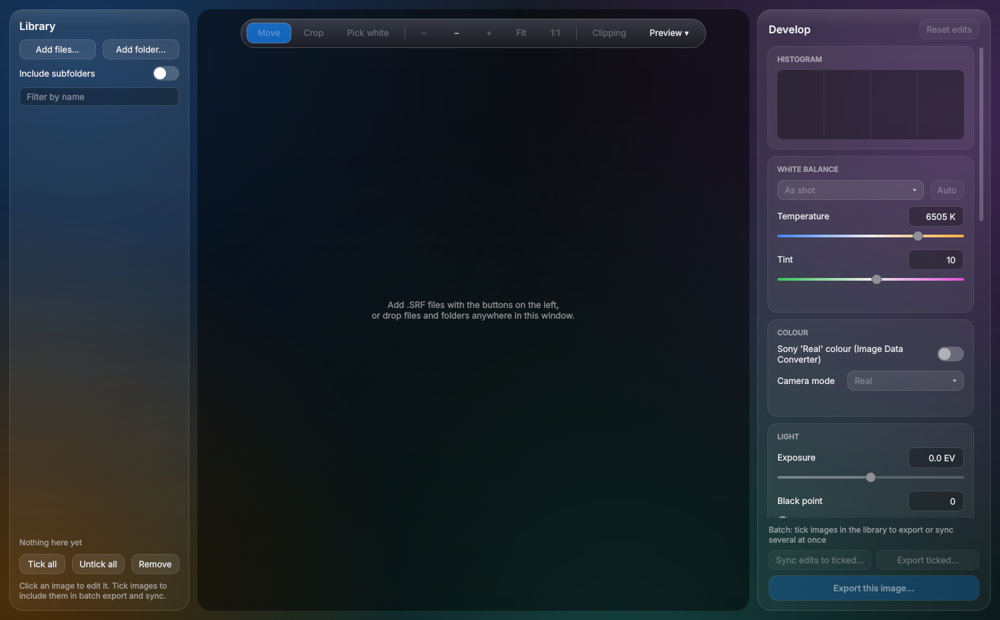

# Sony F-828 RGBE RAW Color Converter

Windows app that converts Sony DSC-F828 RGBE `.SRF` raw files into TIFFs and other formats. It re-implements Sony's discontinued Image Data Converter SR pipeline, including its four-colour demosaic and REAL colour, matching IDC output to within 0.64/255 per pixel. It also ships DCP camera profiles so Lightroom can open F828 raws with accurate colour.



> **Not affiliated with or endorsed by Sony.** "Sony", "DSC-F828" and "Image Data Converter" are trademarks of Sony Group Corporation and are used here only to describe compatibility. This project contains no Sony software.

## Download

Get **`f828_converter.exe`** from the [latest release](https://github.com/wuvshroom/Sony-F-828-RGBE-RAW-Color-Converter/releases/latest). It runs on Windows 10 and 11 without installing anything.

The .exe is not code-signed, so Windows SmartScreen may warn the first time. Click **More info**, then **Run anyway**.

## Features

### Key features

- **Sony REAL and Standard colour, matched to the pixel:** full-size exports reproduce Image Data Converter SR's output to 0.64/255 RMS over every pixel.
- **IDC's own RGBE demosaic:** recreated four-colour demosaic with the least colour noise and no fringes on fine lines.
- **True as-shot white balance:** read from the per-shot camera data, which other raw converters never see.
- **IDC's white-balance presets:** daylight, cloudy, shade, tungsten, fluorescent and flash with Sony's exact gains.
- **Lightroom and Camera Raw profiles:** two DCP profiles fitted to IDC's REAL and Standard looks.
- **DNG export with the Sony look embedded:** Lightroom opens the DNG with IDC's colour, white balance and exposure already set.
- **Export preview:** shows the picture exactly as the saved file will hold it, with its file size.

### Development

- **Default rendering:** an Adobe-style colour matrix and sRGB curve, as an alternative to Sony colour.
- **White balance:** temperature and tint sliders, presets, auto, and a click-to-pick white point.
- **Exposure and black point:** with a soft highlight roll-off.
- **Highlight reconstruction:** rebuilds clipped highlights from the channels that did not clip.
- **Demosaic choice:** IDC, edge-aware, or bilinear.
- **Black level source:** the level the camera recorded in the file (as IDC uses), a level measured from the masked border, or a fixed value.
- **IR false colour:** an Aerochrome-style false-colour look for infrared shots.

### Corrections

- **Chromatic aberration:** automatic or manual lateral CA correction for red/cyan and blue/yellow.
- **Defringe:** removes purple and green fringes on high-contrast edges.
- **Colour noise reduction:** smooths colour blotches, especially in the shadows.
- **Hot and dead pixels:** finds and removes stuck photosites.
- **Crop, straighten, rotate and flip:** with a live crop frame.

### Viewing

- **Zoom and pan viewer:** fit, 1:1 and any zoom, with drag-to-pan.
- **Live RGB histogram and clipping overlay:** shows blown highlights and blocked shadows.
- **Image info:** sensor size, camera settings and EXIF from the raw file.

### Library and batch

- **Thumbnail library:** add files or whole folders (optionally with subfolders) by button or drag and drop.
- **Filter by name:** narrows the library as you type.
- **Sync edits:** copies chosen edits from one image to all ticked images.
- **Batch export:** exports every ticked image in the background, using every CPU core.

### Export

- **Formats:** TIFF, DNG, PNG, JPEG, WebP, AVIF, JPEG XL, JPEG 2000, OpenEXR and BMP (HEIF when running from source).
- **Bit depth and quality:** 8, 16 or 32-bit where the format allows, with per-format quality and compression settings.
- **Colour spaces:** sRGB, Display P3, Adobe RGB, ProPhoto RGB, Rec. 2020 and linear spaces, with an embedded ICC profile.
- **Resize:** by long edge, short edge, width, height or percent, with Lanczos, bicubic or area resampling.
- **Output sharpening:** for screen, matte or glossy prints.
- **File-size targets:** the highest quality that fits a size you set.
- **Metadata:** EXIF and GPS copied from the raw, with an option to leave out the location.
- **Presets:** ready-made settings for archiving, print, web and small shares.

## How it recreates Sony's look

### What IDC actually does

Image Data Converter SR has no colour science of its own for the F828. It reproduces the camera's own colour processor in software, configured from a block of camera settings that the F828 writes, encrypted, into every `.SRF`. This converter recreates that processor and matches its output. In outline, for every pixel:

1. **Sensor to 12-bit:** subtract the per-file black level, apply a per-shot digital gain, and scale the 14-bit sensor values into the processor's 12-bit range.
2. **Demosaic:** soft, low-pass colour planes for R, G, B and Emerald, plus a sharp luminance taken from the green and emerald checkerboard.
3. **4x3 colour matrix:** one fixed RGBE-to-RGB matrix, the same in every file.
4. **White balance after the matrix:** the as-shot R and B gains are applied to the matrix *output*, not to the raw channels.
5. **Tone curve:** a 97-point segmented curve stored in each file. REAL and Standard differ only here.
6. **Luma and colour difference:** `Y = (19 R' + 38 G' + 7 B') / 64` with a contrast gain, and colour differences `R' - G'` and `B' - G'`.
7. **The REAL colour stage:** each colour difference gets a cross term from the other and a gain, and both are chosen by sign. That makes it a different linear map in each quadrant of the colour plane, with coefficients recorded per shot.
8. **Chroma suppression and kill:** colour is reduced in deep shadows and bright highlights, and removed on the very steepest edges. The thresholds are re-mapped through the tone curve on every render.
9. **Output:** 8-bit luma and chroma, 4:2:2 chroma pairs, a 3x3 luma filter, then 8 to 16 bits and YCbCr to RGB. The final scale is exactly 255.5/257.

Every step runs in the same integer arithmetic, with the same rounding and clipping, so a full-size export comes out as IDC's own TIFF does.

### Why earlier attempts fell short

Other ways of handling F828 raws, such as general-purpose raw converters and custom camera profiles built from a colour chart, all share the same assumptions. The F828 breaks each one.

- **One matrix for every shot.** Standard raw pipelines describe a camera with a single linear matrix. REAL colour is a quadrant-dependent map, applied after a tone curve, with coefficients that change from shot to shot. No single matrix, and no single chart-based profile, can reproduce it.
- **White balance in the wrong place.** Standard raw pipelines balance the raw channels *before* the matrix. IDC balances *after* it. On saturated colours the two orders give different results that no later correction can undo.
- **The wrong as-shot white balance.** The white-balance values that ordinary raw decoders read from an `.SRF` are identical in every file. The real ones sit only in the encrypted per-shot camera data, so "As Shot" elsewhere is always the same guess.
- **The emerald channel handled like Bayer data.** Demosaics built for Bayer sensors either treat emerald as a second green, which causes maze patterns and false colour because its spectral response differs, or interpolate four colours generically, which does not match how IDC builds its picture from soft colour planes and a sharp green/emerald luminance.
- **A missing tone curve.** Each file carries its own curve, and the REAL/Standard choice lives only there. Generic curves change contrast and, through the colour stage, saturation.
- **Small steps that add up.** Shadow and highlight chroma suppression, the re-mapped thresholds, 8-bit intermediates, 4:2:2 chroma and the 255.5/257 output scale are each worth only fractions of a level. Together they separate "close" from "identical". An earlier version of this converter that fitted a matrix and curve to IDC's output was off by up to 30/255 on saturated colours.

### How close it gets

Tested against IDC SR 1.1's own 16-bit TIFF exports of 11 shots, covering natural scenes and a colour chart, REAL and Standard, under five white-balance settings:

| Measure | Result |
|---|---|
| Every pixel, RMS | 0.64 / 255 |
| Flat colour, RMS | 0.10 / 255 |
| Live preview (faster floating-point path), flat colour | 0.2 / 255 |
| DNG with the REAL profile embedded, rendered by Adobe's DNG SDK | 0.39 / 255 median, 0.85 worst shot |

## Lightroom and Camera Raw profiles

The [`lightroom-profile`](lightroom-profile) folder has two DNG camera profiles fitted to IDC's colour:

- `Sony DSC-F828 IDC Real.dcp`
- `Sony DSC-F828 IDC Standard.dcp`

Copy both into `%APPDATA%\Adobe\CameraRaw\CameraProfiles` and restart Lightroom. Then either:

- run `python lightroom-profile/f828_xmp.py <folder of .SRF files>` to write sidecars that set each shot's real as-shot white balance and the matching profile, or
- export a DNG from the app with **Look: Sony 'Real'**, which embeds the profile, white balance and exposure in the file.

A profile can only approximate the REAL colour stage, because DCP profiles are not per-shot. For exact colour, export from the app. See [lightroom-profile/README.md](lightroom-profile/README.md) for details.

## Run from source

Python 3.11 or newer.

```
pip install -r requirements.txt
pip install -r requirements-optional.txt   # optional: JPEG XL, OpenEXR and more
python f828_converter.py [files or folders]
```

## Build the .exe

On Windows, from this folder:

```
build.bat
```

That creates a clean virtual environment, installs `requirements-build.txt` and runs `pyinstaller f828_converter.spec`. The result is `dist\f828_converter.exe` with both camera profiles bundled, plus `dist\f828-lightroom-profiles-v20.1.0.zip`.

## Speed

A full-size export with Sony colour takes about a second on a 4-core machine. The colour processor, its output step and IDC's demosaic are compiled with [Numba](https://numba.pydata.org); the first launch compiles them in the background (about 15 seconds) and keeps them on disk for later launches. Without Numba installed the same steps run in numpy, about 4x slower, with identical output. Setting the environment variable `F828_NO_NUMBA=1` forces the numpy path, for comparing the two.

## Known issues

- Dark-to-mid flat areas are 0.2-0.5/255 low in the dominant colour on some strongly red or blue shots.
- The camera profiles have been verified in Adobe's DNG SDK renderer, not yet inside Lightroom itself.

## License

**Free for noncommercial use** under the [PolyForm Noncommercial License 1.0.0](LICENSE). This is source-available software, not OSI "open source".

- You may use, study, modify and share it, and build new projects from it, for any noncommercial purpose.
- You may **not** sell it, sell a modified version, or charge for support or services around it.
- Modified or redistributed versions must keep the `Required Notice` lines from [LICENSE](LICENSE) and link to the official repository, https://github.com/wuvshroom/Sony-F-828-RGBE-RAW-Color-Converter, in their documentation.

Third-party components and their licenses are listed in [THIRD-PARTY-NOTICES.md](THIRD-PARTY-NOTICES.md).
